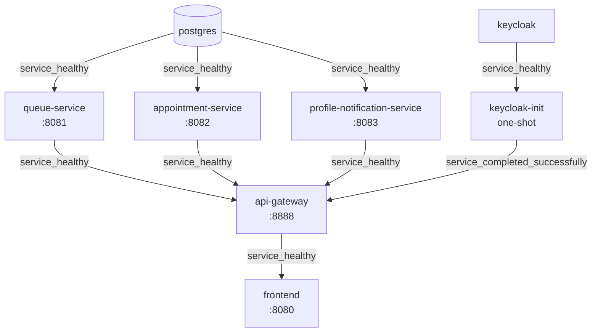

# Design Document

## Overview

The Tiko baseline healthchecks feature centralises container readiness configuration inside `docker-compose.yml` and adds a lightweight static verification script so that configuration drift — a service added as a `service_healthy` dependency without a matching `healthcheck` block — is caught before the stack is started.

The core changes are already in place in `docker-compose.yml`:
- All five Spring Boot containers (`queue-service`, `appointment-service`, `profile-notification-service`, `api-gateway`, `frontend`) have `healthcheck` stanzas.
- All twenty required environment variables use `${VAR:?message}` syntax to enforce their presence at Compose parse time.
- The `api-gateway` `depends_on` block gates startup on `condition: service_healthy` for all three business services and on `condition: service_completed_successfully` for `keycloak-init`.

The remaining deliverables are:
1. `scripts/check-compose-healthchecks.sh` — a ≤30-line POSIX sh script that statically verifies the config output for Linux/macOS and CI environments.
2. A README update (the README already documents the startup command; it needs a brief mention of both check scripts).

**Existing script**: `scripts/check-compose-healthchecks.ps1` already exists and was created alongside the `docker-compose.yml` changes. It performs the same verification using PowerShell's native JSON parsing (`docker compose --env-file .env.example config --format json | ConvertFrom-Json`). The design **extends** the existing work by adding a POSIX sh companion script. Both scripts co-exist: `.ps1` for Windows local dev, `.sh` for Linux/macOS and CI. No second `.ps1` is created.

No application code changes are required.

---

## Architecture

### Startup Dependency Graph



The two auth-path and data-path chains merge at `api-gateway`. Nothing starts the gateway until all three business services and the Keycloak bootstrap one-shot are ready. The frontend waits for the gateway.

### Networks

| Network | Members | Purpose |
|---|---|---|
| `edge` | `keycloak`, `api-gateway`, `frontend` | Browser-facing; published ports |
| `backend` | `keycloak`, `keycloak-init`, `postgres`, `queue-service`, `appointment-service`, `profile-notification-service`, `api-gateway` | Service-to-service; not published to host |

Business services are on `backend` only; they cannot receive direct connections from the host.

---

## Components and Interfaces

### 1. Healthcheck Stanzas in `docker-compose.yml`

Each Spring Boot container uses `wget` from `busybox` (the only HTTP client present in `eclipse-temurin:21-jre-alpine`) to probe `/actuator/health`. The probe address is `127.0.0.1` rather than `localhost` to avoid IPv6 resolution inside the container, which can produce a spurious connection failure on dual-stack systems.

**Implemented parameters for all three business services:**

| Parameter | Value | Rationale |
|---|---|---|
| `test` | `wget -qO- http://127.0.0.1:<port>/actuator/health \| grep -q UP \|\| exit 1` | Checks response body contains the string `UP`; `-qO-` suppresses progress and writes body to stdout |
| `interval` | `10s` | Polls every 10 seconds; fast enough to detect startup without busy-looping |
| `timeout` | `3s` | Spring Actuator responds in under 100 ms when healthy; 3 s is generous without masking a hung JVM |
| `retries` | `6` | 6 × 10 s = 60 s of retries after `start_period`; total unhealthy window ≈ 120 s |
| `start_period` | `60s` | Covers JVM cold-start plus initial Flyway/Hibernate schema setup before the first probe counts against `retries` |

> **Timeout and retries**: The implemented values (`timeout: 3s`, `retries: 6`) are tighter than the initial AC estimates. Requirements 1 AC 1–3 have been updated to match the implementation. `timeout: 3s` is generous for Actuator (which responds in under 100 ms when healthy) and `retries: 6` gives a ~60 s window after `start_period` before Docker marks the container `unhealthy` — fast enough to surface a stuck JVM without false-positive failures on slow machines.

**Ports by service:**

| Service | Internal port |
|---|---|
| `queue-service` | `8081` |
| `appointment-service` | `8082` |
| `profile-notification-service` | `8083` |
| `api-gateway` | `8888` |
| `frontend` | `8080` |

**Compose-level override**: When a `healthcheck` stanza is present in `docker-compose.yml` for a service that also has a `HEALTHCHECK` instruction in its Dockerfile, Docker uses the Compose-level stanza and ignores the Dockerfile instruction. No Dockerfile changes are needed; both can coexist safely.

### 2. Environment Variable Enforcement

Every reference to a Required_Variable in `docker-compose.yml` uses the form `${VAR:?VAR is not set - copy .env.example to .env}`. Compose evaluates this at parse time (before any container starts). If `VAR` is absent or empty, Compose prints the error message and exits non-zero immediately — the stack never reaches image pull or container creation.

This enforcement is already complete for all twenty Required_Variables.

### 3. Verification Scripts

Two companion scripts perform identical checks on different platforms.

#### `scripts/check-compose-healthchecks.ps1` (existing — Windows / pwsh)

Already implemented. Uses:
```powershell
$json = docker compose --env-file .env.example -f $ComposeFile config --format json
$services = ($json | ConvertFrom-Json).services
```
Iterates all services, finds `depends_on` entries with `condition: service_healthy`, checks the dependency has a `healthcheck` property. Prints `FAIL: <service> depends on <dep> (service_healthy) but <dep> has no healthcheck` and exits 1 on any failure; prints `OK:` and exits 0 on success.

#### `scripts/check-compose-healthchecks.sh` (new — POSIX sh / Linux / macOS / CI)

**grep/awk vs. `--format json | jq`**

| Approach | Robustness | Reason |
|---|---|---|
| `grep/awk` on YAML output | Fragile | YAML indentation and quoting are sensitive; a service name containing a hyphen or the word `healthcheck` can break naive pattern matching |
| `--format json \| jq` | Robust | Structured JSON is unambiguous; the same query the `.ps1` uses, just with `jq` instead of `ConvertFrom-Json` |

**Decision: use `--format json | jq`**. `jq` is standard on all Linux CI runners (GitHub Actions, GitLab CI) and available via Homebrew on macOS. It eliminates all YAML-indentation fragility in a single flag.

**Algorithm** (mirrors the `.ps1` exactly):
1. Run `docker compose --env-file .env.example config --format json 2>/dev/null` and capture output.
2. Use `jq` to find every service whose `depends_on` contains an entry with `condition: service_healthy`.
3. For each such target service, check whether it has a non-null `healthcheck` key in the JSON.
4. Exit 1 naming any offending service, or exit 0 with a success message.

**Script** (≤30 lines, POSIX sh):

```sh
#!/bin/sh
# Usage: sh scripts/check-compose-healthchecks.sh
# Requires: docker compose, jq
set -eu

cd "$(dirname "$0")/.."
JSON=$(docker compose --env-file .env.example config --format json 2>/dev/null)

# For each service that is a depends_on target with condition:service_healthy,
# check that the target service itself defines a healthcheck block.
FAILED=0
for DEP in $(printf '%s' "$JSON" | jq -r '
  .services
  | to_entries[]
  | .value.depends_on // {}
  | to_entries[]
  | select(.value.condition == "service_healthy")
  | .key
' | sort -u); do
  HAS=$(printf '%s' "$JSON" | jq -r --arg s "$DEP" '.services[$s].healthcheck // empty')
  if [ -z "$HAS" ]; then
    echo "FAIL: service '$DEP' is a service_healthy dependency but has no healthcheck block." >&2
    FAILED=1
  fi
done

if [ "$FAILED" -eq 0 ]; then
  echo "OK: every depends_on service_healthy target declares a healthcheck."
fi
exit "$FAILED"
```

This script starts no containers. `docker compose config --format json` only parses and resolves the Compose file; it never pulls images or creates any container.

### 4. README

The README already documents the startup sequence in the "Run locally" section:

```sh
docker compose up --build
```

The README update adds a brief mention of the check script so developers know it exists for pre-flight validation.

---

## Data Models

Not applicable. This feature modifies Docker Compose configuration and adds a shell script. There are no data structures, schemas, or persistence concerns.

---

## Error Handling

### Probe failure — business service

When a probe fails (wget exits non-zero or the response body does not contain `UP`), Docker increments the failure counter. After `retries: 6` consecutive failures following `start_period`, Docker marks the container `unhealthy`. Compose propagates this: any service with `condition: service_healthy` on that container is blocked and will not start. The developer sees the unhealthy status in `docker compose ps`.

### Missing required variable

If any Required_Variable is absent when `docker compose config` or `docker compose up` is run:

```
service "queue-service" refers to undefined environment variable "QUEUE_DB_PASSWORD" - is not set - copy .env.example to .env
```

Compose exits with status 1 immediately. No container starts. The error message names the missing variable and tells the developer exactly what to do.

### Check script — missing healthcheck

If `scripts/check-healthchecks.sh` finds a service listed as a `service_healthy` dependency without a `healthcheck` block:

```
ERROR: service 'my-new-service' is a service_healthy dependency but has no healthcheck block.
```

The script exits with status 1. This is intended to run in CI so the error surfaces before the broken Compose file reaches a developer machine.

### Check script — Docker not available

If `docker compose config` fails (Docker not installed, daemon not running), the script inherits the non-zero exit from `set -e` and surfaces the Docker error message on stderr. No special handling is needed.

---

## Correctness Properties

*A property is a characteristic or behavior that should hold true across all valid executions of a system — essentially, a formal statement about what the system should do. Properties serve as the bridge between human-readable specifications and machine-verifiable correctness guarantees.*

### Property 1: Probe exit code reflects health body

*For every* service S that appears as a `depends_on` target with `condition: service_healthy`, the healthcheck probe command for S exits 0 if and only if `GET /actuator/health` for that service returns a response body containing the string `UP`.

**Validates: Requirements 1.4, 1.5**

### Property 2: Missing required variable causes compose to fail

*For every* Required_Variable V in the set `{KC_ADMIN, KC_ADMIN_PASSWORD, POSTGRES_SUPERUSER, POSTGRES_SUPERUSER_PASSWORD, QUEUE_DB_NAME, QUEUE_DB_USER, QUEUE_DB_PASSWORD, APPOINTMENTS_DB_NAME, APPOINTMENTS_DB_USER, APPOINTMENTS_DB_PASSWORD, PROFILES_DB_NAME, PROFILES_DB_USER, PROFILES_DB_PASSWORD, TIKO_CLIENT_PASSWORD, TIKO_AGENT_PASSWORD, TIKO_ADMIN_PASSWORD, KEYCLOAK_PORT, GATEWAY_PORT, FRONTEND_PORT, FRONTEND_DEV_PORT}`, running `docker compose config` with V absent from the environment exits with a non-zero status code and emits a message that names V.

**Validates: Requirements 3.2, 3.3**

### Property 3: Check script correctly classifies any compose configuration

*For every* Docker Compose configuration, `scripts/check-compose-healthchecks.sh` exits 0 if and only if every service listed as a `condition: service_healthy` dependency has a `healthcheck` block present in the `docker compose config` output; and exits 1 naming any service that is missing a `healthcheck` block.

**Validates: Requirements 5.2, 5.3, 5.4**

---

## Testing Strategy

### Static analysis (no containers required)

These checks run on a fresh clone in CI with no `.env` file and no running containers:

| Check | Command |
|---|---|
| All `service_healthy` deps have healthchecks | `sh scripts/check-compose-healthchecks.sh` |
| PowerShell variant (Windows / CI with pwsh) | `pwsh -File scripts/check-compose-healthchecks.ps1` |
| Config parses cleanly with `.env.example` | `docker compose --env-file .env.example config >/dev/null` |
| No plain `${VAR}` references remain | `grep -P '\$\{[A-Z_]+\}' docker-compose.yml` → empty |
| `.env.example` lists all required variables | `grep -c 'replace-with' .env.example` ≥ 10 |
| README contains startup command | `grep -q 'docker compose up' README.md` |
| Script is ≤30 lines | `wc -l scripts/check-compose-healthchecks.sh` |

### Live transcript verification

After `cp .env.example .env` and filling in real credentials, run:

```sh
docker compose up --build
```

Expected sequence visible in `docker compose logs --follow`:
1. postgres reaches healthy
2. queue-service, appointment-service, profile-notification-service start and reach healthy
3. keycloak reaches healthy; keycloak-init runs and exits 0
4. api-gateway starts (after all three business services and keycloak-init are ready) and reaches healthy
5. frontend starts and reaches healthy

Verify final state:
```sh
docker compose ps
# All services show "healthy" (keycloak-init shows "exited (0)")
curl -sf http://localhost:${FRONTEND_PORT}/
curl -sf http://localhost:${GATEWAY_PORT}/actuator/health | grep -q UP
```
