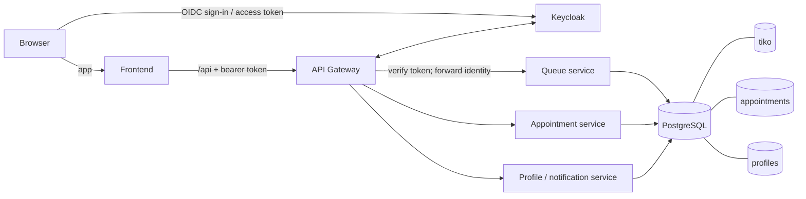
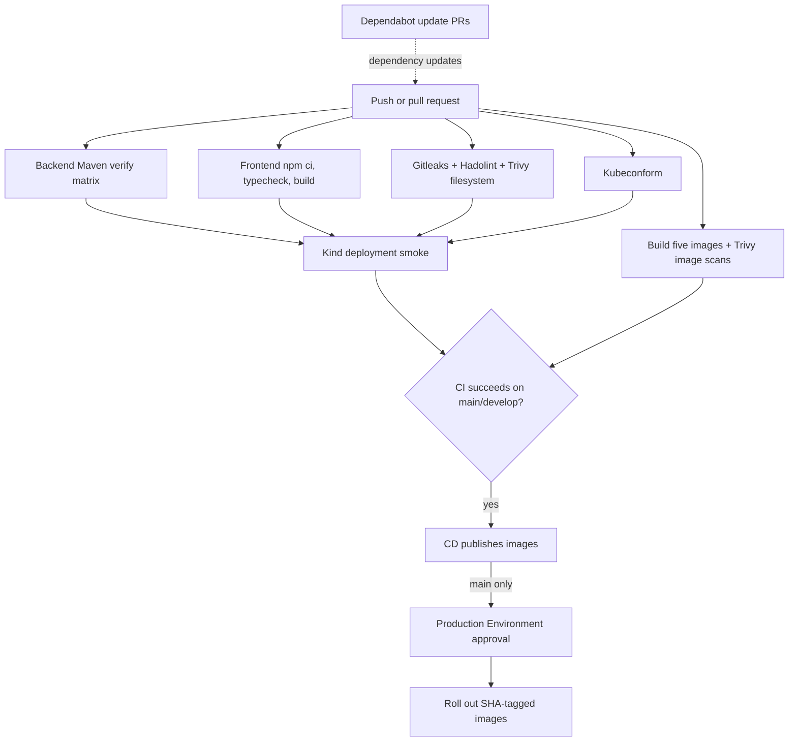

# Tiko architecture

Evidence checked at commit `3fbe578` on 2026-11-11. “Verified” means a command was run in
this worktree or its configured kind cluster; source and manifest inspection is labelled
“validated statically only.”

## Runtime

```text
Browser ── app ──► Frontend ── /api ──► API Gateway ──► Queue service ─────┐
   │                                         │          Appointment service ├─► PostgreSQL
   └──────────── sign in / token ───────────►│          Profile/notification┘    ├─ tiko
                  Keycloak                   │                                  ├─ appointments
                                             └────────► Keycloak                └─ profiles
```



Compose binds the frontend, gateway, and Keycloak to loopback host ports. PostgreSQL and the
three business services are not published to the host. Kubernetes exposes the frontend and
Keycloak through Ingress; gateway, business services, and PostgreSQL use internal Services.

## Security layers

```text
Browser ── PKCE login ──► Keycloak ── signed access token ──► Gateway
                                                            1. RS256 signature/JWKS
                                                            2. issuer + audience
                                                            3. remove caller X-Auth-*
                                                            4. set verified X-Auth-*
                                                            ▼
                                                   business service
                                              client / agent / admin checks
                                                            │
                                                        PostgreSQL

Calico NetworkPolicies: ingress-nginx → frontend/Keycloak;
                        frontend → gateway → business services → PostgreSQL
```

- Gateway configuration accepts `RS256`, checks the configured issuer and requires audience
  `tiko-api`. The issuer is environment-specific: Compose uses the browser-facing localhost
  realm URL; the Kubernetes ConfigMap uses
  `http://keycloak.tiko.local/realms/tiko`.
- The gateway replaces `X-Auth-Subject`, `X-Auth-Username`, `X-Auth-Email`, `X-Auth-Client`,
  and `X-Auth-Roles` from the verified token. Caller-supplied versions are not trusted.
- Realm roles are `client`, `agent`, and `admin`; queue counter operations require `agent` or
  `admin`. The bootstrap grants new self-registered users the `client` role.
- Kubernetes application containers are configured non-root with read-only root filesystems.
  The PostgreSQL data-directory init container is an explicit root exception (it needs `chown`).
- NetworkPolicies select the ingress paths above. The observed kind cluster has Calico
  installed; kind's default kindnet alone would not enforce these policies. No egress policy
  is configured.

## Kubernetes layout

Kustomize places the stack in namespace `tiko`: frontend, gateway, queue, appointment, profile
/ notification, Keycloak, a PostgreSQL StatefulSet with persistent storage, and the one-shot
`keycloak-bootstrap` Job. An NGINX Ingress serves `tiko.local` and `keycloak.tiko.local`.
NetworkPolicies isolate ingress to the frontend and Keycloak, then allow the gateway to reach
business services and business services to reach PostgreSQL.

The checked-in `k8s/secret.yaml` still has `REPLACE_WITH_*` placeholders. Do not apply that
bundle unchanged; create a real `tiko-secrets` Secret first.

## CI/CD



Dependabot is configured separately in `.github/dependabot.yml`. GitHub Actions CI also runs
Gitleaks, Hadolint, a filesystem Trivy scan, Kustomize/kubeconform validation, and a kind smoke
deployment. CD publishes only after successful CI on `main` or `develop`; production rollout is
for `main` and uses the `production` Environment.

Latest checked PR run: `42962403258`, commit `3fbe578`. `gh run list --limit 5` and
`gh pr checks 1` both show the run failed. All listed jobs passed except
**Docker build and Trivy / frontend**. Its Trivy scan reported 12 HIGH/CRITICAL findings
(11 HIGH, 1 CRITICAL), so the image scan exits non-zero. Backend builds, frontend build,
Gitleaks, Hadolint, filesystem scan, manifest validation, other four image scans, and kind
smoke test passed in that run. The PR is not green.

## Evidence and status

| Delivered (commit) | Verified with evidence | Validated statically only | Not done |
|---|---|---|---|
| Current inspected baseline `3fbe578`; CI security scanning and Dependabot `0ce96ec`; CD success gate `f007160` | Docker Engine responded; kind cluster `tiko` had Ready workloads and a completed bootstrap Job; gateway returned 401 without a token; Calico probe allowed gateway-labelled traffic and timed out for a non-matching label; latest CI results above | JWT, role, header rewriting, Kubernetes layout, security contexts, ingress, and policy rules match the checked-in source/manifests | Compose browser login, ticket and appointment creation, agent/client call-next responses, GitLab run status, and npm audit |
| Container/CI fixes `f1c0b47`, `746cf25`, `d109a6c`, `3fbe578` | Temporary policy probes were deleted; no probe pods remain | No HPA, metrics-server, tenant isolation, egress restriction, Flyway, observability stack, Argo CD, Kyverno, or k6 configuration was found in the reviewed repository | Those roadmap items remain unimplemented; do not infer production readiness |

## Known limitations and roadmap

- No HPA, metrics-server, tenant isolation, or egress restriction is configured.
- The PostgreSQL init container runs as root to change data-directory ownership.
- Local development uses credentials from an untracked `.env`; the Kubernetes Secret file is
  only a placeholder.
- npm advisory status is **not done**: `npm` was unavailable for this check, so no audit count
  is claimed. The GitLab pipeline is also **not done**; no GitLab run was verified.
- Flyway migrations, observability, Argo CD, Kyverno, and k6 are not configured.
- The latest GitHub Actions run is not green: the frontend image Trivy scan fails as detailed
  above.
